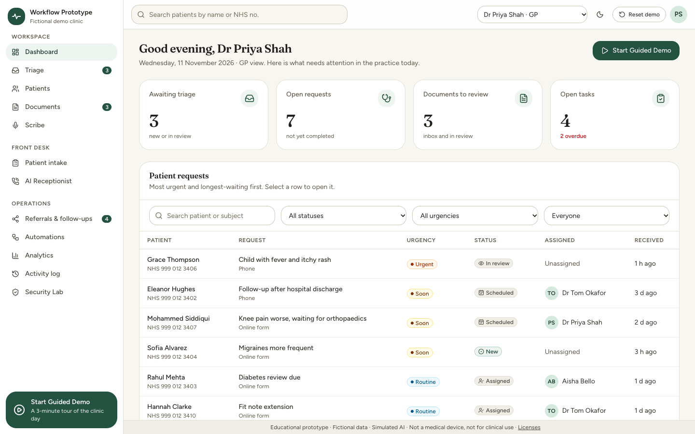
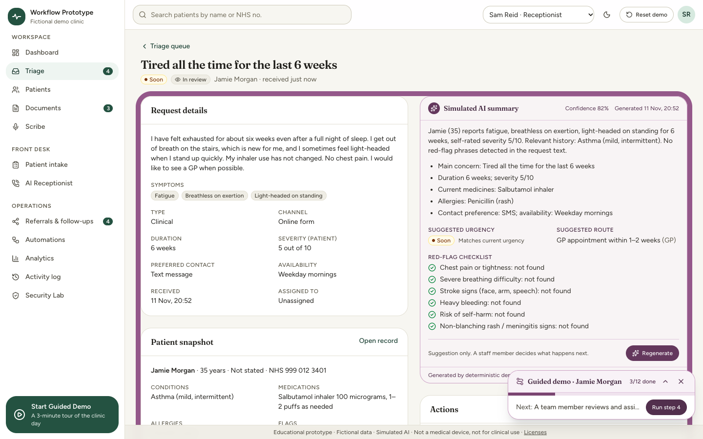
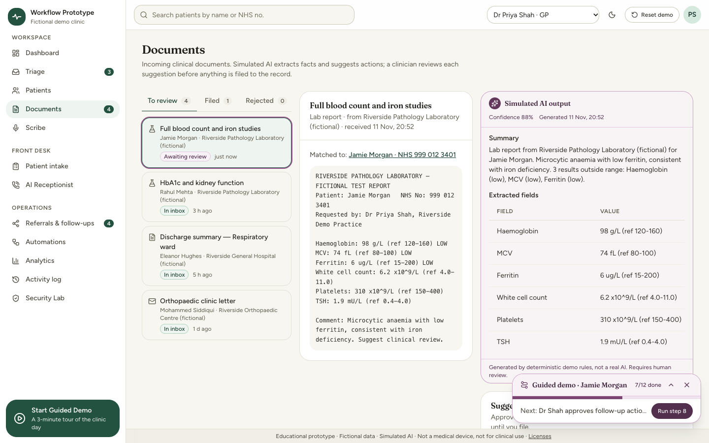
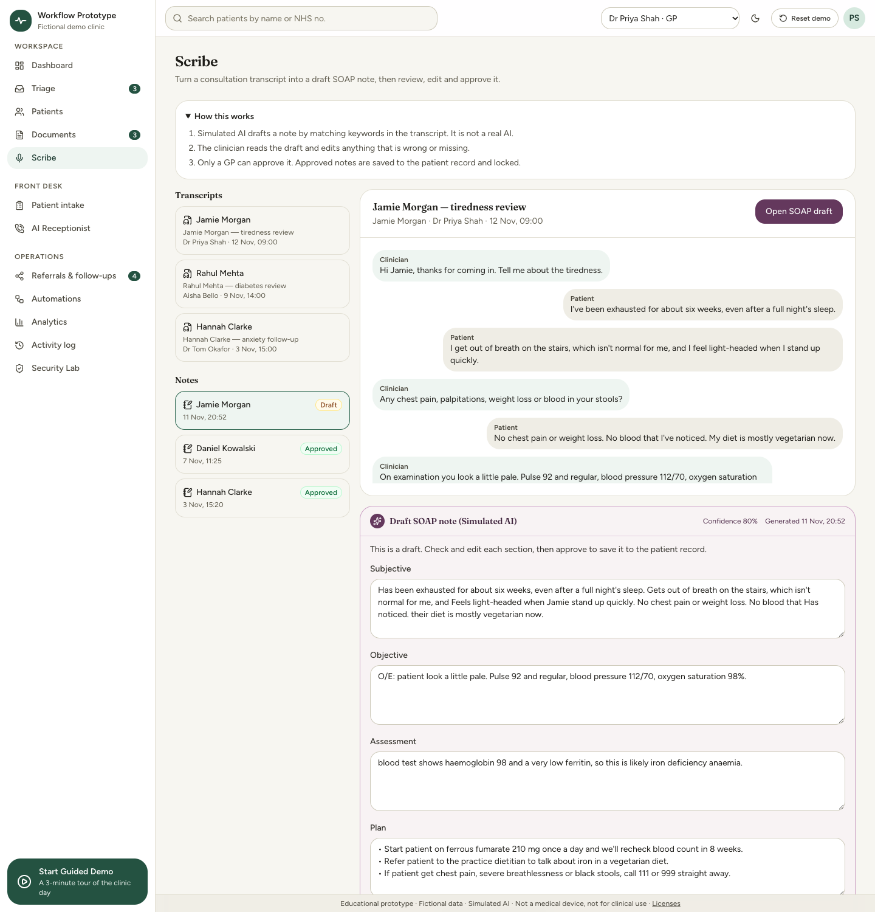
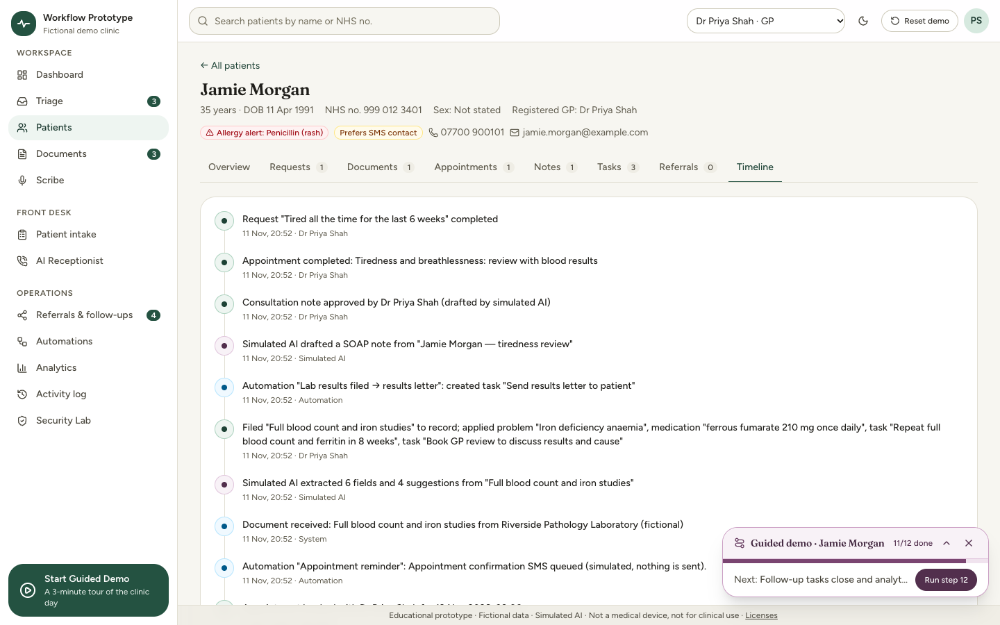
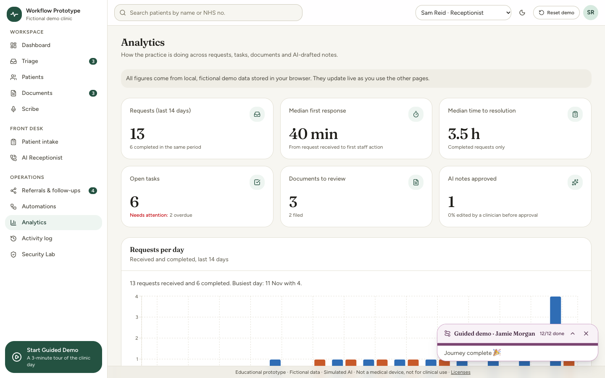
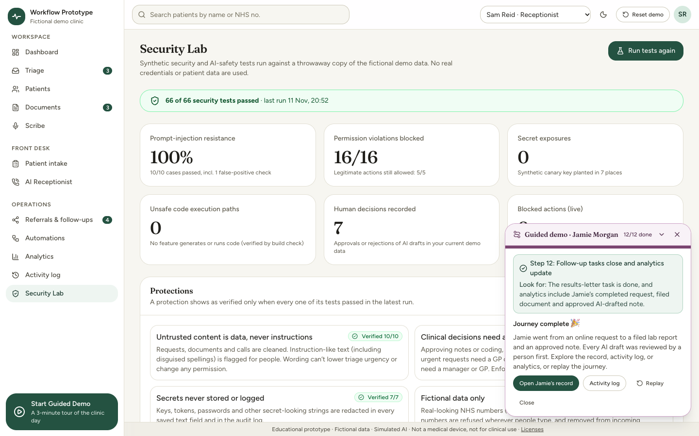

# Healthcare Workflow Prototype

## 👋 Hi, here's what I'm doing

I'm exploring how AI could take some of the busywork off healthcare teams, without ever taking the decisions away from people.

This repo is my working prototype of that idea. It's a pretend clinic where patient requests, lab reports and consultation notes come in. A *simulated* AI drafts summaries and suggestions, and staff review and approve everything before it touches a patient record.

It's a learning and portfolio project. Everything in it is fictional, and it runs entirely in your browser: no accounts, no servers, no real AI calls, and no real patient data.

**What I'm focusing on**
- **AI drafts, people decide.** Nothing the AI suggests is saved until the right person approves it.
- **Safe by default.** Role-based approvals, an audit trail, and a built-in Security Lab that tries to break the app and shows the results.
- **Calm, readable design** for workflows that are usually anything but.

**Try it:** follow [Getting Started](#getting-started) below, then click **Start Guided Demo** to follow one fictional patient from first request to approved consultation note.

**Feedback welcome.** If you spot a bug or have an idea, feel free to open an issue.

---

### Objective

This project is an interactive healthcare operations prototype demonstrating how AI-assisted workflows can support patient intake, clinical documentation, request management, and care coordination.

The prototype illustrates how healthcare teams can organize incoming requests, review structured patient information, generate simulated AI summaries, and manage follow-up actions through a unified interface.

It is designed to demonstrate healthcare workflow concepts, product functionality, and human-in-the-loop automation using entirely synthetic data.

### Key Features
- Patient intake and triage dashboard
- AI-assisted document processing simulation
- Clinical note generation simulation
- Patient records and follow-up tracking
- Interactive clinic worklist
- Operational analytics

### Product Overview

The prototype models a day at a fictional primary-care clinic:

- **Requests arrive** from an online intake form or a simulated phone receptionist and land in a prioritized worklist.
- **Simulated AI drafts** structured request summaries, extracts results from clinical documents, and turns consultation transcripts into SOAP notes.
- **People decide.** Every AI output is clearly labelled, and nothing changes a patient record until an authorized staff member reviews and approves it. Switching roles in the top bar shows how approval rights differ between clinicians, nurses, and front-desk staff.
- **Everything connects.** Approved actions update the patient record, follow-up tasks, the activity timeline, and analytics in real time.

A **Security Lab** runs synthetic security and AI-safety tests in the browser and shows the results. It covers prompt-injection attempts, permission violations, secret leakage, real personal data, resource limits, and human-approval gates.

A **guided demo** walks through one fictional patient's journey in 12 steps, from first request to approved consultation note. Each step performs a real action in the app. **Reset demo** restores the original data at any time.

### Screenshots

| Clinic worklist | Request triage with simulated AI summary |
|---|---|
|  |  |

| Document review | Clinical note drafting |
|---|---|
|  |  |

| Patient timeline | Operational analytics |
|---|---|
|  |  |

| Security Lab |
|---|
|  |

### Technology

React · TypeScript · Vite · Tailwind CSS · React Router · Zustand · Recharts · Lucide icons · Fraunces & Figtree typefaces (self-hosted)

The app runs entirely in the browser. It has no backend, accounts, external APIs, or API keys. Demo data is stored in the browser's local storage, and all "AI" behaviour is produced by deterministic rules.

### Getting Started

Requires [Node.js](https://nodejs.org) 20.19+ or 22.12+.

```bash
npm install
npm run dev        # start locally at http://localhost:5173
npm run build      # production build in dist/
npm run preview    # serve the production build
```

### License

The source code is released under the [MIT License](LICENSE): you may use, copy, and modify it. It is provided as is, without warranty of any kind.

Third-party components keep their own licenses. See [THIRD_PARTY_NOTICES.md](THIRD_PARTY_NOTICES.md); the same notices are available in the running app via the **Licenses** link.

### Disclaimer

This is an independent, non-commercial educational prototype. It is not affiliated with, endorsed by, or connected to any healthcare software provider.

All patients, medical records, and clinical scenarios are fictional. Simulated AI outputs are for demonstration purposes only and must not be used for diagnosis, treatment, or clinical decision-making.

The project does not connect to real healthcare systems or process real patient information.

This software is not a medical device and has not been certified or approved for clinical use. Patient identifiers use reserved test number ranges, and clinical codes are placeholders.
